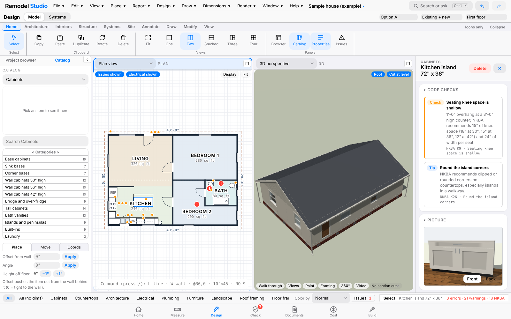
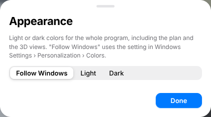
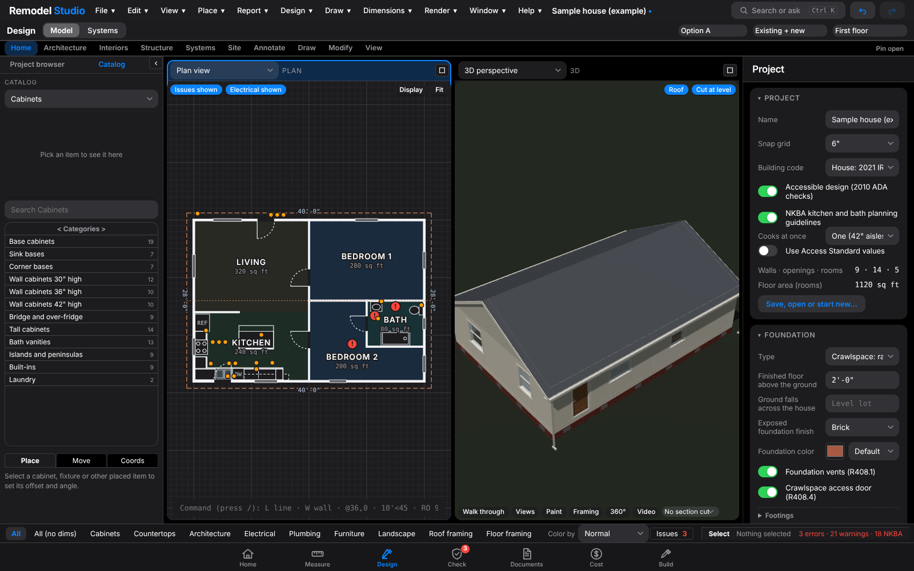

## Welcome

Remodel Studio is a complete remodel-planning program for one designer. It takes a job from the first site visit to the hand-over binder: measure the house from photos and a tape, draw the existing building and the proposed remodel, design kitchens and baths with real cabinet lines, check the design against the 2021 IRC/IBC, the 2010 ADA Standards and the NKBA Kitchen and Bath Planning Guidelines, size the structure and the systems, price the work, print a plan set and a presentation, and run the build with a schedule, orders, inspections and a punch list.

Everything runs on your own computer. Projects are ordinary files, nothing is sent anywhere, and no account or subscription is needed.

This manual covers every page, tool, dialog, setting and report in the program, version 2.3. It is written to be read front to back once, then kept as a reference: the table of contents, the glossary and the index at the back take you straight to any feature.

### How this manual is organized

| Part | What it covers |
|---|---|
| **1 Getting started** | Installing the program, the layout of the window, light and dark mode, and a 20-minute first project. |
| **2 The window** | The menus, the tab bar, the command palette, standards, lessons and keyboard shortcuts. |
| **3 Designing** | The Designer, every drawing and placement tool, selecting and editing, the 3D view, levels, roofs and site. |
| **4 The Library and vendors** | The catalog, custom items, vendor catalogs and price books, appliances, finishes and paint. |
| **5 Kitchens and baths** | Cabinets, countertops, tile, hardware, NKBA guidelines and the kitchen drawings. |
| **6 Measuring** | Photos, tape measurements, scans and plan images, making walls, field notes. |
| **7 Checking** | The Check page and every code, accessibility, NKBA, structure, clash and energy rule. |
| **8 Structure and systems** | Spans and loads, framing, wall removal, electrical, plumbing, heating and cooling, energy, lighting. |
| **9 Documents** | The plan set, schedules, keynotes, details, revisions, presentation, finish board, exports. |
| **10 Cost** | Builder's list, estimate, change orders, shopping, selections and orders, budget, bids, cut plan. |
| **11 Building** | The dashboard, job schedule, field notes, wall photos, inspection prep, homeowner binder. |
| **12 Site and settings** | Site and landscape tools and every project setting. |
| **Appendices** | File formats, troubleshooting, where to get help, the glossary and the index. Keyboard shortcuts are listed in Part 2. |

### Conventions

- **Bold** names are things you see on the screen: buttons, menu items, tabs, fields.
- *Design › Model* means the Design tab in the tab bar, then its Model page. *File › Import › Vendor catalog…* means a menu, a submenu and an item.
- Keys are shown as **Ctrl+K**, **Shift**, **Enter**. Single-letter tool keys (**W** for Wall) work with no modifier while the plan has focus.
- Lengths are entered the way you say them: `12'6"`, `12-6`, `150"`, `6 ft 3 in`, `1.9 m` or `45 cm`. A bare number in a length box is read as feet where a wall or room length is expected and as inches for small sizes (the hint beside the box tells you which).
- A **note** box like the one below marks a tip, a limit or a thing that is easy to miss.

> **Note.** The program calculates planning numbers: spans, loads, panel sizes, heat loss, prices and schedules are there to design and compare, not to replace an engineer's stamp, a licensed trade's design or a contractor's quote.

## Installing and starting

### The Windows program

Remodel Studio for Windows is a single installer, **Remodel Studio Setup 2.3.0.exe**. Double-click it, pick where to install (the default is your user folder, so no administrator password is needed), and finish. A **Remodel Studio** shortcut is placed on the Start menu and the desktop, and `.rsp` project files are associated with the program so double-clicking one opens it.

The first start opens the **sample house** so there is something to look at. Use **File › New…** to start your own project.

To update, run the newer installer over the old one; projects, standards and vendor catalogs are kept. To remove the program use *Apps* in Windows Settings; your project files are never deleted.

### The web version

The same program is also a single web page that runs in Chrome or Edge, with no installation:

- **Remodel Studio offline.html** works with no internet connection at all (every library it needs is inside the file). Keep it anywhere, for example `Documents\Remodel Studio\app`, and open it in the browser.
- **Remodel Studio.html** is the small copy; it needs an internet connection the first time it loads its libraries.

In the browser, projects are saved in the browser's own storage and can also be saved to or opened from files on your computer (Chrome and Edge ask for permission the first time). Browser storage belongs to that browser on that computer; clearing site data clears the projects, so keep files of anything that matters.

### Where things live

| What | Windows program | Web version |
|---|---|---|
| Projects | `.rsp` files wherever you save them (**File › Show file in folder** opens the place). | The browser's project list (**File › Open…**) and/or `.json` files you download or save. |
| Backups | Automatic copies in the program's backup folder (**File › Backups…**). | Named **Versions** in browser storage (**File › Versions…**). |
| Vendor catalogs, store prices, custom items, standards, appearance | On this computer, shared by every project. | In this browser's storage. |
| Photos, scans and renders | Stored on this computer; the project remembers where each is pinned. | Stored in the browser; the project remembers the pins. |

### System requirements

Windows 10 or 11, 64-bit, 8 GB of memory and a graphics driver that supports WebGL 2 (any computer from the last ten years). A mouse with a scroll wheel makes drawing much faster; a touchpad works. A second monitor is useful for the plan on one and the 3D view on the other (**Window › Two views side by side** also does this on one screen).

## A tour of the window

The window is laid out like a modern iOS or iPad app:

1. **Menu bar** (top). The brand mark, the **File**, **Edit** and **Help** menus (on the Design › Model page the Designer adds View, Place, Report, Design, Draw, Dimensions, Render and Window), the project name, **Search or ask** (the command palette, **Ctrl+K**) and **Undo** / **Redo**.
2. **Title bar**. The name of the current workflow, a **page control** for its pages (for example *Model · Systems* on the Design tab), and on the right the **design option**, the **remodel layer** (*Existing + new*, *Existing only*, *New only*), the **level** and, outside the Designer, the **Library** button.
3. **Content**. The page itself: the Designer, the dashboard, the Check page, the sheets, the cost tabs and so on.
4. **Tab bar** (bottom). Seven tabs in job order: **Home**, **Measure**, **Design**, **Check**, **Documents**, **Cost**, **Build**. The Check tab wears a red badge with the number of errors (or an amber one with the number of warnings). Each tab remembers the page you used last.

### Light and dark mode

Open **Help › Appearance (light or dark)…** (or press **Ctrl+K** and type *appearance*). Choose:

- **Follow Windows** — the program uses the color setting in *Windows Settings › Personalization › Colors* and changes when Windows does. This is the default.
- **Light** — always light.
- **Dark** — always dark. The plan, the 3D view, the sheets preview and every page follow; printed sheets and PDFs always print on white.

The choice is kept on this computer and applies to every project. Press **Done** to close the dialog.

## Your first project in twenty minutes

This walk-through draws a small addition, puts a kitchen in it, checks it, and prices it. Everything it uses is explained in full later in the manual.

1. **Start a project.** **File › New… › Blank project**. Name it with **File › Rename project…** and fill in the address and client in the Project panel (select nothing in the Designer and the Inspector shows the **Project** panel).
2. **Draw the walls.** On the Design tab, press **W** (or **Architecture › Wall**). In the option bar pick *Exterior 2×6*. Click a corner, type `24'` and press **Enter**, type `16'` **Enter**, `24'` **Enter**, then click the first corner to close. Press **Esc**. Walls are **New** work; existing walls you measured are set to *Existing* in the Inspector.
3. **Make the room.** Press **R** and click inside the walls. Name it *Kitchen* and set **Use** to *Kitchen* in the Inspector; the floor finish, paint and ceiling height are there too.
4. **Doors and windows.** Press **D**, hover a wall and click where the door goes; press **N** for windows. Each one's size, sill height, swing and style are in the Inspector; the Library has more types.
5. **Cabinets.** Open the **Catalog** in the left dock, choose **Cabinets › Base cabinets**, click *B36* and click along the wall; the back snaps to the wall. Use **Interiors › Base cabinet run** to fill a whole wall at once, then **Wall cabinet run** above it. Pick the sink base, the range and the refrigerator from the **Appliances** category. Set the door style, finish and hardware once in the **Kitchen style (all cabinets)** section of any cabinet's panel.
6. **Countertop and splash.** Select any base cabinet: the **Countertops (all)** section of its panel sets the material, color, edge, thickness, overhang and backsplash for the whole job. Select the room for the **Tile** section: a 4" or full-height splash, a tub surround or a wainscot.
7. **Look at it.** Press the **3D** tab in the pane header, or **Home › Views › Two** to see the plan and the model side by side. Drag to orbit, scroll to zoom, right-drag to pan. **Walk through** puts you at eye level.
8. **Check it.** Press the **Check** tab. Errors are red, warnings amber, NKBA tips blue. Click an issue, then **Show it in Design** to jump to it. Fix the design and the list updates by itself.
9. **Price it.** Press the **Cost** tab. The **Builder's list** is the take-off; **Estimate and labor** adds labor, tax and markup; set your rates once in **My standards** so every project starts with them.
10. **Print it.** Press **Documents**. Tick the sheets you want and **Print plans (PDF)**. The **Board presentation** makes a slide deck and the **Finish board** a sample page.
11. **Save.** **Ctrl+S**. The dashboard on the **Home** tab now shows the job at a glance.

> **Tip.** Press **Ctrl+K** at any time and type what you want to do (*wall*, *joists*, *finish board*, *how many bedrooms*). It finds commands, pages, tools, levels and catalog items, and answers questions about the project.
